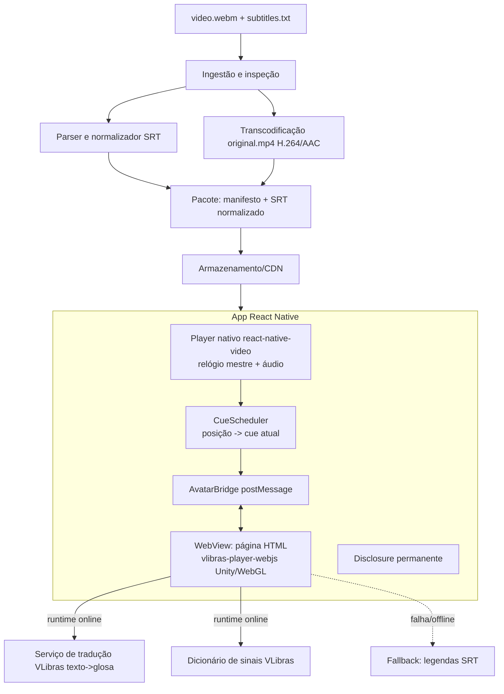
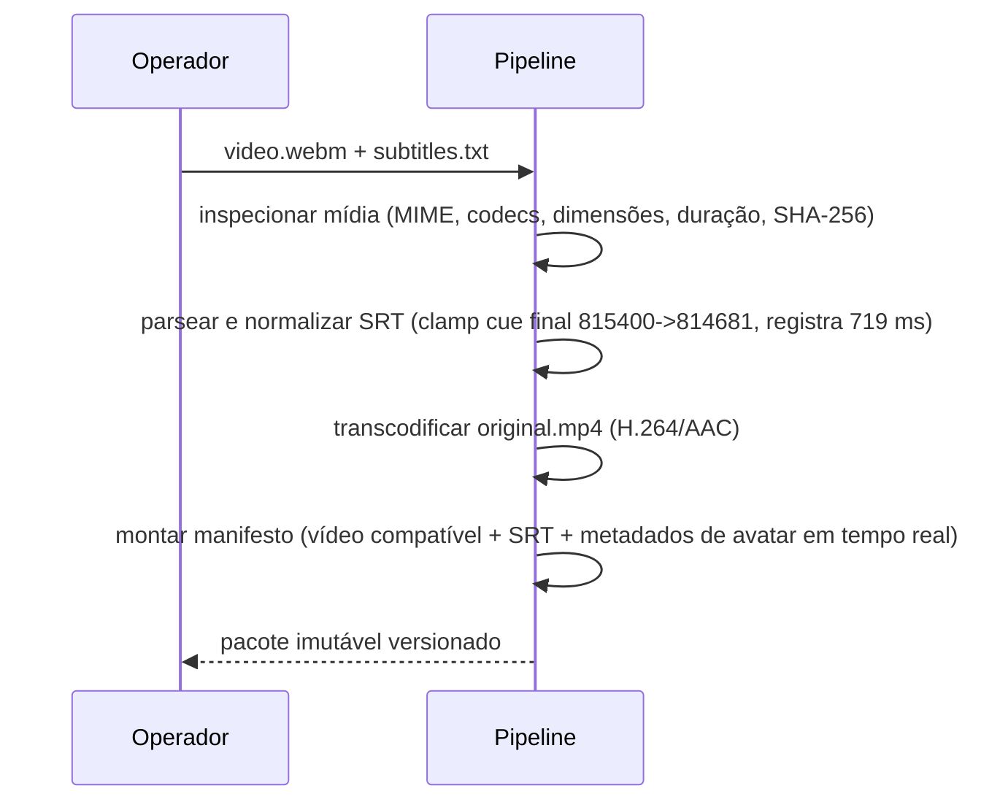

# Design Document: Libras Translation Player

## Overview

A funcionalidade entrega um player React Native que reproduz `video.webm` (transcodificado para `original.mp4`) acompanhado de uma janela de avatar 3D de Libras renderizada **ao vivo** pelo player oficial open-source `vlibras-player-webjs` (Unity/WebGL) embutido em uma WebView. O avatar é declaradamente experimental: tradução automática por avatar não equivale a interpretação humana e não recebe selo de conformidade linguística ou de acessibilidade.

Os arquivos reais orientam o fluxo: `subtitles.txt` é SRT com 267 cues temporizados, não texto puro, e `video.webm` contém vídeo AV1 1920×1080 a 24000/1001 fps e áudio Opus. A duração medida do vídeo é 814.681 ms; o último cue termina em 815.400 ms. O pipeline reutiliza os tempos do SRT, registra a divergência de 719 ms e limita o cue final à duração da mídia. Não há alinhamento forçado.

A mudança arquitetural central desta revisão: o avatar real de Libras do VLibras **existe somente como um player WebGL/Unity que roda no cliente** (`vlibras-player-webjs`, LGPL-3.0). Não há backend oficial que entregue um MP4 pré-renderizado do avatar sincronizado a um vídeo arbitrário. Portanto, a solução integra o player oficial dentro do app via `react-native-webview`: o vídeo nativo é o relógio mestre e, a cada transição de cue, o app envia o texto do cue para a WebView traduzir e animar em tempo real. A sincronização resultante é **aproximada**, por natureza do avatar automático, e isso é documentado explicitamente.

## Architectural Decision Record

### ADR-001 (SUPERSEDED): Composição offline de MP4 com janela de avatar

**Status: REVERTIDA.** A V1 deste design previa gerar offline um `prototype-avatar.mp4` compondo clipes de avatar sobre a fonte, reproduzido por um único player nativo sem WebView e sem dependência de rede no playback.

**Por que foi descartada:** a investigação das fontes oficiais públicas (org `spbgovbr-vlibras`) mostrou que o avatar 3D de Libras do VLibras é produzido pelo player `vlibras-player-webjs`, um componente Unity/WebGL que anima **ao vivo no navegador/cliente**. Ele não é um serviço que devolve vídeo de avatar pré-renderizado e sincronizável a uma linha do tempo arbitrária. O serviço hospedado "VLibras Vídeo" até gera vídeo com avatar, mas restringe o uso dessas traduções automáticas em produções audiovisuais sincronizadas e recomenda intérprete humano; não é automatizável nem publicável para este fim. Assim, não existe caminho oficial e autorizado para obter os clipes necessários à composição offline. A abordagem de MP4 pré-renderizado do avatar é, portanto, inviável com fontes reais e sai do caminho principal.

### ADR-002 (ACCEPTED): Avatar real em tempo real via WebView

**Status: ACEITA (decisão do usuário).** Integrar o `vlibras-player-webjs` real dentro do app React Native via `react-native-webview`. Uma página HTML instancia o player; o avatar 3D anima ao vivo a partir do texto das legendas enviado pelo app. Isso **substitui** a composição offline de MP4.

**Consequências assumidas conscientemente:**

- O playback agora **depende de serviços online do VLibras** (tradução texto→glosa e dicionário de sinais). A V1 não dependia de rede no playback; esta versão sim.
- A sincronização avatar×fala passa a ser **aproximada** (latência de tradução e de estados de animação), não quadro-a-quadro.
- Introduz-se uma bridge React Native ↔ WebView e uma WebView sobreposta, com custo de complexidade e de ciclo de vida (carregamento, erro, offline).
- O licenciamento LGPLv3 do player passa a reger a distribuição do bundle.

### Partes DEPRECATED removidas do caminho principal

Reposicionadas como **modo legado opcional**, não construídas nesta entrega:

- `renderPrototypeVariant` (composição offline da janela de avatar).
- A variante de mídia `prototype-avatar.mp4`.
- A análise de encaixe temporal **para composição offline** (`analyzeTemporalFit` no sentido de aceitar/rejeitar clipes para render). A noção de "encaixe" é substituída, no caminho ao vivo, por disparo de cue dirigido pelo relógio do vídeo.
- O `Renderer` e o `Package_Validator` da variante de avatar pré-renderizada.

## Architecture



### Main flow (runtime, no app)

```mermaid
sequenceDiagram
    participant U as Usuário
    participant V as Player nativo (relógio mestre)
    participant C as CueScheduler
    participant B as AvatarBridge
    participant W as WebView (vlibras-player-webjs)
    participant O as Serviços online VLibras

    U->>V: play
    V->>C: onProgress(positionMs)
    C->>C: resolver cue atual por timestamps do SRT
    alt Mudança de cue e avatar habilitado
        C->>B: postMessage({type:"cue", text})
        B->>W: player.translate(text) / play(gloss)
        W->>O: traduzir texto->glosa + baixar sinais
        O-->>W: glosa + assets
        W-->>B: event gloss:start / animation:progress / gloss:end
        B-->>C: status (aproximado, não frame-exato)
    else WebView ou serviço indisponível
        W-->>B: event error (ou timeout)
        B-->>C: avatarUnavailable
        C->>V: manter vídeo + exibir legendas (fallback)
    end
    Note over V,W: Vídeo é o relógio mestre; avatar segue de forma aproximada
```

### Pipeline offline (preparo do pacote)



### Design decisions

- **Avatar ao vivo via WebView**: é o único caminho real para o avatar 3D oficial do VLibras, que só existe como WebGL/Unity no cliente. Ver ADR-002.
- **Vídeo nativo como relógio mestre**: o `react-native-video` controla posição, play/pause/seek e o áudio; o avatar é dirigido pelas transições de cue do SRT normalizado.
- **Sincronização aproximada e honesta**: a animação segue o texto do cue com latência; o sistema não promete sincronização quadro-a-quadro nem a rotula como interpretação humana.
- **Dependência de rede no playback**: assumida e tratada com erro/offline e fallback para legendas.
- **Pacote enxuto**: o pacote publicado é vídeo compatível + SRT normalizado + metadados do avatar em tempo real. Sem variante MP4 de avatar pré-renderizada.
- **Fallback explícito**: sem WebView funcional ou sem serviço VLibras disponível, o app mantém vídeo, áudio e legendas, informando que o avatar está indisponível.

## Components and Interfaces

Os contratos TypeScript são design, não implementação.

```typescript
type Milliseconds = number;
type MediaId = string;
type Uri = string;
type Sha256 = string;

type AvatarMode = "realtime-webview-prototype" | "unavailable";
type AvatarRuntimeState =
  | "idle"
  | "loading"
  | "ready"
  | "translating"
  | "playing"
  | "error";

type TranscriptCue = Readonly<{
  id: string;
  index: number;
  startMs: Milliseconds;
  endMs: Milliseconds;
  textPtBr: string;
  sourceFormat: "srt";
}>;

type MediaVariant = Readonly<{
  kind: "original";
  uri: Uri;
  mimeType: "video/mp4";
  videoCodec: "h264";
  audioCodec: "aac";
  durationMs: Milliseconds;
  width: number;
  height: number;
  sha256: Sha256;
}>;

type AvatarRuntimeConfig = Readonly<{
  playerBundleUri: Uri;          // página HTML que instancia vlibras-player-webjs
  avatarName: string;            // ex.: "icaro" | "hosana" | "guga"
  defaultSpeed: number;          // setSpeed()
  requiresOnlineServices: true;  // tradução texto->glosa e dicionário online
  licenseReviewId: string;       // revisão LGPLv3 + direitos dos avatares/dicionário
}>;

type TranslationManifest = Readonly<{
  schemaVersion: 3;
  mediaId: MediaId;
  durationMs: Milliseconds;
  avatarMode: AvatarMode;
  avatarAvailable: boolean;      // capacidade de avatar em tempo real configurada
  disclosure: "Tradução automática experimental por avatar; não equivale a intérprete humano.";
  variants: readonly MediaVariant[]; // somente a variante original
  transcriptUri: Uri;
  avatarRuntime?: AvatarRuntimeConfig;
  generationWarnings: readonly string[];
}>;
```

```typescript
// Ponte app React Native <-> WebView (postMessage)

type AppToWebMessage =
  | Readonly<{ type: "init"; config: AvatarRuntimeConfig }>
  | Readonly<{ type: "cue"; cueId: string; text: string }>
  | Readonly<{ type: "pause" }>
  | Readonly<{ type: "stop" }>
  | Readonly<{ type: "setSpeed"; speed: number }>
  | Readonly<{ type: "changeAvatar"; name: string }>;

type WebToAppMessage =
  | Readonly<{ type: "load" }>                                  // player carregado
  | Readonly<{ type: "gloss:start"; cueId: string }>
  | Readonly<{ type: "animation:progress"; value: number }>
  | Readonly<{ type: "gloss:end"; cueId: string }>
  | Readonly<{ type: "animation:end"; cueId: string }>
  | Readonly<{ type: "error"; code: string; message: string }>;

interface AvatarBridge {
  init(config: AvatarRuntimeConfig): void;
  sendCue(cueId: string, text: string): void;
  pause(): void;
  stop(): void;
  onMessage(handler: (msg: WebToAppMessage) => void): void;
}

interface CueScheduler {
  // Dirigido pela posição do player de vídeo (relógio mestre)
  resolveCueAt(positionMs: Milliseconds): TranscriptCue | null;
  // Emite transição quando o cue ativo muda
  onCueChange(handler: (cue: TranscriptCue | null) => void): void;
}

interface TranslationPackageRepository {
  getManifest(mediaId: MediaId): Promise<TranslationManifest>;
}

interface LibrasPlayerController {
  load(manifest: TranslationManifest): Promise<void>;
  play(): Promise<void>;
  pause(): Promise<void>;
  seek(positionMs: Milliseconds): Promise<void>;
  setAutomaticAvatar(enabled: boolean): Promise<void>;
  getSnapshot(): PlaybackSnapshot;
}
```

```typescript
// Superfície do player oficial exposta dentro da WebView (vlibras-player-webjs).
// Não é implementada por nós; é consumida pela página HTML embutida.
interface VLibrasWebPlayer {
  // new VLibras.Player({ target: { name, path } })
  load(wrapperElement: HTMLElement): void;
  translate(text: string): void;
  play(gloss?: string): void;
  pause(): void;
  stop(): void;
  setSpeed(speed: number): void;
  changeAvatar(name: string): void;
  toggleSubtitle(): void;
  // eventos: "load" | "gloss:start" | "gloss:end"
  //          | "animation:progress" | "animation:end" | "error"
}
```

### Component responsibilities

- **Ingestion** valida MIME, codecs, dimensões, duração, encoding do SRT e hashes.
- **SRT Normalizer** parseia, ordena e limita cues à duração da mídia sem alterar texto silenciosamente (preservado do design V1).
- **Transcoder** produz `original.mp4` H.264/AAC para reprodução nativa compatível.
- **Package Builder** monta o manifesto imutável com a variante original, o SRT normalizado e a configuração de avatar em tempo real; não produz variante de avatar.
- **Native Video Player (`react-native-video`)** reproduz o vídeo/áudio e é o relógio mestre.
- **CueScheduler** resolve o cue ativo a partir da posição do vídeo e emite transições.
- **AvatarBridge** serializa mensagens app↔WebView via `postMessage`.
- **WebView host + vlibras-player-webjs** carrega a página HTML, instancia o player oficial e anima o avatar ao vivo consumindo os serviços online do VLibras.
- **Disclosure** mantém aviso permanente e legível de tradução automática experimental.

## Data Models

```text
/media/{mediaId}/{revision}/
  manifest.json
  original.mp4
  transcript.normalized.srt
  avatar-runtime.json        # AvatarRuntimeConfig (bundle, avatar, licença)
  poster.webp
  checksums.sha256
```

Nota: `prototype-avatar.mp4` e `avatar-generation-report.json` **não** fazem parte do caminho principal nesta revisão (ver ADR-001 / partes DEPRECATED).

```typescript
type PlaybackSnapshot = Readonly<{
  mediaId: MediaId;
  positionMs: Milliseconds;
  durationMs: Milliseconds;
  isPlaying: boolean;
  isBuffering: boolean;
  automaticAvatarEnabled: boolean;
  automaticAvatarAvailable: boolean;
  avatarRuntimeState: AvatarRuntimeState;
  activeCueId: string | null;
}>;
```

## Key Functions with Formal Specifications

### `parseAndNormalizeSrt` (preservado da V1)

```typescript
function parseAndNormalizeSrt(
  srt: string,
  mediaDurationMs: Milliseconds,
): readonly TranscriptCue[];
```

**Preconditions**

- `srt` é Unicode decodificado e contém cues SRT parseáveis.
- `mediaDurationMs > 0`.

**Postconditions**

- Cues ordenados de forma estável por início, fim e índice de origem.
- Todo cue satisfaz `0 <= startMs < endMs <= mediaDurationMs`.
- Texto preservado após normalização de fins de linha.
- O cue final é limitado de 815.400 ms para 814.681 ms e a divergência de 719 ms é registrada.
- Divergências fora de faixa além da tolerância de clamp falham a validação em vez de ajuste silencioso.

**Loop invariant**: todo cue emitido antes do índice `i` tem limites válidos e mantém sua identidade de origem.

### `resolveCueAt` (novo — relógio mestre é o vídeo)

```typescript
function resolveCueAt(
  cues: readonly TranscriptCue[],
  positionMs: Milliseconds,
): TranscriptCue | null;
```

**Preconditions**: `cues` normalizados e ordenados; `positionMs >= 0`.

**Postconditions**

- Retorna o único cue `c` tal que `c.startMs <= positionMs < c.endMs`, ou `null` em intervalo sem fala.
- Função pura: não altera estado de reprodução nem o SRT.

### `scheduleAvatarFromPlayback` (novo — disparo por transição de cue)

```typescript
function scheduleAvatarFromPlayback(
  scheduler: CueScheduler,
  bridge: AvatarBridge,
  avatarEnabled: boolean,
): void;
```

**Preconditions**: bridge inicializada; WebView em estado `ready` quando `avatarEnabled` é verdadeiro.

**Postconditions**

- A cada **mudança** de cue ativo (dirigida pela posição do vídeo), e somente nela, `bridge.sendCue(cueId, text)` é chamado uma vez.
- Em intervalo sem fala, nenhuma nova tradução é disparada (avatar permanece em pose ociosa/estado anterior).
- Se `avatarEnabled` é falso, nenhuma mensagem de cue é enviada.
- A relação avatar×fala é **aproximada**; a função não garante casamento quadro-a-quadro.

**Loop invariant**: no máximo um cue é considerado ativo por vez; transições preservam a ordem cronológica dos cues.

### `handleAvatarRuntimeFailure` (novo — fallback de runtime)

```typescript
function handleAvatarRuntimeFailure(
  snapshot: PlaybackSnapshot,
  error: WebToAppMessage & { type: "error" },
): PlaybackSnapshot;
```

**Postconditions**

- O vídeo e o áudio continuam reproduzindo sem interrupção.
- `automaticAvatarAvailable` passa a falso e as legendas SRT passam a ser exibidas.
- O fallback **não** depende do avatar nem dos serviços online do VLibras em tempo de reprodução.

### `createManifest` (atualizado — sem variante de avatar)

```typescript
function createManifest(
  original: MediaVariant,
  transcriptUri: Uri,
  avatarRuntime: AvatarRuntimeConfig | null,
): TranslationManifest;
```

**Postconditions**

- `original` e transcript sempre presentes; `variants` contém somente a variante original.
- `avatarAvailable` é verdadeiro se e somente se existir `avatarRuntime` válido com revisão de licença registrada.
- Sem `avatarRuntime`, o manifesto define `avatarMode: "unavailable"` e registra o motivo.
- Nenhuma variante de avatar pré-renderizada é referenciada.

### `switchAvatarMode` (atualizado — habilita/desabilita avatar ao vivo)

```typescript
async function switchAvatarMode(
  enabled: boolean,
  positionMs: Milliseconds,
  wasPlaying: boolean,
): Promise<PlaybackSnapshot>;
```

**Postconditions**

- O player de vídeo mantém a posição e o estado de play/pause (relógio mestre inalterado).
- Habilitar o avatar mostra a WebView e, no próximo cue, dispara a tradução; desabilitar oculta a WebView e para o player web (`stop()`).
- Somente uma instância de mídia emite áudio: o áudio provém do player de vídeo nativo; a WebView do avatar não emite áudio concorrente.

### `renderPrototypeVariant` — **DEPRECATED (modo legado opcional)**

```typescript
// REMOVIDO DO CAMINHO PRINCIPAL. Mantido apenas como registro de modo legado.
// Compunha prototype-avatar.mp4 offline. Inviável com fontes reais do VLibras:
// o avatar só existe como WebGL/Unity ao vivo (ver ADR-001).
```

### `analyzeTemporalFit` — **DEPRECATED (modo legado opcional)**

```typescript
// REMOVIDO DO CAMINHO PRINCIPAL. Fazia sentido apenas para composição offline.
// No caminho ao vivo, o disparo de cue é dirigido pelo relógio do vídeo
// e a sincronização é assumidamente aproximada.
```

## Example Usage

```tsx
<LibrasTranslationPlayer
  mediaId="chocolate-from-cacao"
  manifestUri="https://media.example/media/chocolate-from-cacao/v3/manifest.json"
  initialAutomaticAvatarEnabled={true}
  showCaptionsWhenAvatarUnavailable={true}
/>
```

```typescript
const manifest = await repository.getManifest("chocolate-from-cacao");
await controller.load(manifest);

if (manifest.avatarAvailable && manifest.avatarRuntime) {
  // Carrega a WebView com a página do vlibras-player-webjs
  bridge.init(manifest.avatarRuntime);
  await controller.setAutomaticAvatar(true);
} else {
  showCaptionFallback(manifest.transcriptUri);
  showMessage("Avatar automático indisponível; exibindo vídeo com legendas.");
}

// Relógio mestre: vídeo nativo dirige as transições de cue
scheduler.onCueChange((cue) => {
  if (cue && controller.getSnapshot().automaticAvatarEnabled) {
    bridge.sendCue(cue.id, cue.textPtBr); // WebView: translate(text)/play()
  }
});
```

```html
<!-- Página HTML embutida na WebView: instancia o player oficial -->
<script src="vlibras-player.js"></script>
<script>
  const player = new VLibras.Player({ target: { name: "icaro", path: "./target" } });
  player.load(document.getElementById("avatar"));
  player.on("load", () => post({ type: "load" }));
  player.on("gloss:start", () => post({ type: "gloss:start", cueId: current }));
  player.on("gloss:end", () => post({ type: "gloss:end", cueId: current }));
  player.on("error", (e) => post({ type: "error", code: "PLAYER_ERROR", message: String(e) }));

  window.addEventListener("message", (ev) => {
    const msg = JSON.parse(ev.data);
    if (msg.type === "cue") { current = msg.cueId; player.translate(msg.text); }
    if (msg.type === "pause") player.pause();
    if (msg.type === "stop") player.stop();
    if (msg.type === "setSpeed") player.setSpeed(msg.speed);
    if (msg.type === "changeAvatar") player.changeAvatar(msg.name);
  });
</script>
```

## Correctness Properties

### Property 1: Limites temporais (preservada)

Para todo cue publicado `c`, `0 <= c.startMs < c.endMs <= manifest.durationMs`.

**Validates: Requirements 3.2, 3.4**

### Property 2: Preservação do SRT (preservada)

Todo texto de cue de entrada aparece no cue normalizado correspondente; qualquer descarte é erro bloqueante.

**Validates: Requirements 3.3, 3.5, 3.6**

### Property 3: Vídeo como relógio mestre (nova)

Toda transição de cue e todo disparo de tradução do avatar derivam da posição de reprodução do player de vídeo nativo; o avatar nunca redefine a posição do vídeo.

**Validates: Requirements 1.1, 1.3**

### Property 4: Disparo por transição de cue (nova)

Para cada mudança do cue ativo, com avatar habilitado, exatamente uma mensagem de cue é enviada à WebView; em intervalo sem fala, nenhuma tradução nova é disparada.

**Validates: Requirements 2.1, 6.2, 6.3, 7.1, 7.2**

### Property 5: Sincronização aproximada e honesta (nova)

O sistema não afirma casamento quadro-a-quadro entre avatar e fala; a animação segue o texto do cue com latência admitida.

**Validates: Requirements 9.1, 9.3, 14.1, 14.2**

### Property 6: Fallback de runtime (nova)

Falha da WebView ou indisponibilidade dos serviços online do VLibras resulta em vídeo + áudio + legendas, sem interromper a reprodução e sem depender do avatar no playback.

**Validates: Requirements 2.4, 8.4, 8.5, 13.2, 13.3, 13.4**

### Property 7: Disponibilidade coerente (atualizada)

`avatarAvailable` é verdadeiro se e somente se o manifesto contém `avatarRuntime` válido com revisão de licença registrada.

**Validates: Requirements 12.2, 12.3**

### Property 8: Fallback total (preservada)

Ausência de configuração de avatar ou falha de runtime ainda produz experiência reproduzível com `original.mp4` e SRT.

**Validates: Requirements 13.1, 13.2, 13.4**

### Property 9: Áudio único (atualizada)

Em todo estado do player, no máximo uma instância emite áudio: o player de vídeo nativo; a WebView do avatar não emite áudio concorrente.

**Validates: Requirements 1.2**

### Property 10: Divulgação (preservada)

Toda reprodução com avatar mostra, de forma permanente e legível, que a tradução é automática, experimental e não equivalente a intérprete humano.

**Validates: Requirements 14.1, 14.2, 14.3**

### Property 13: Áudio único e WebView sem áudio concorrente (nova)

A WebView do avatar não emite áudio concorrente; o áudio provém somente do player de vídeo nativo.

**Validates: Requirements 8.6**

### Property 11: Sem automação de serviços proibidos (nova)

O sistema não automatiza o serviço hospedado "VLibras Vídeo" nem incorpora o VLibras Widget/Hand Talk para simular integração; usa somente o player oficial `vlibras-player-webjs` carregando seus assets/target conforme documentado.

**Validates: Requirements 15.3, 15.4, 15.5**

### Property 12: Licença respeitada (nova)

A distribuição do bundle cumpre a LGPLv3 do `vlibras-player-webjs` (atribuição, manutenção de avisos, modo de distribuição) e a revisão de direitos dos avatares e do dicionário está registrada antes de habilitar o avatar.

**Validates: Requirements 18.1, 18.2, 18.3**

## Error Handling

```typescript
type RuntimeErrorCode =
  | "INVALID_SRT"
  | "DURATION_MISMATCH"
  | "WEBVIEW_LOAD_FAILED"
  | "VLIBRAS_PLAYER_ERROR"
  | "TRANSLATION_SERVICE_UNAVAILABLE"
  | "DICTIONARY_FETCH_FAILED"
  | "NETWORK_OFFLINE"
  | "ASSET_INTEGRITY_FAILED";
```

- SRT inválido ou discrepância de duração além da tolerância bloqueia o preparo do pacote (pipeline offline).
- Falha ao carregar a WebView ou o player web → `avatarAvailable` efetivo falso e fallback para legendas; o vídeo continua.
- Indisponibilidade dos serviços online (tradução/dicionário) ou dispositivo offline → avatar entra em estado `error`, app recorre a legendas e informa indisponibilidade.
- Erros do player web (`error`) são propagados pela bridge e tratados como indisponibilidade de avatar, nunca como interrupção do vídeo.
- Durante playback, o app nunca automatiza o VLibras Vídeo, nem abre o Widget, nem acessa endpoints inferidos.

## Testing Strategy

- Testes unitários para SRT, clamp do cue final e `resolveCueAt` (preservados/atualizados).
- Testes da bridge: serialização de mensagens app↔WebView, disparo único por transição de cue, e fallback ao receber `error`.
- Testes de agendamento: o relógio mestre é o vídeo; seek reposiciona o cue ativo e dispara (ou não) tradução coerentemente.
- Testes baseados em propriedades para limites temporais, preservação do texto, disparo por transição de cue, fallback de runtime e áudio único.
- Testes de integração da WebView com o player oficial em ambiente controlado (mock dos serviços online quando permitido pela licença/termos).
- Testes de rede: offline, serviço de tradução indisponível, dicionário inacessível → verificar fallback e disclosure.
- Validação de mídia para H.264/AAC, duração, hashes, range requests e preservação do áudio.
- Avaliação com pessoas fluentes em Libras para medir utilidade do protótipo; não transforma tradução automática em interpretação humana.
- Testes iOS e Android para play, pause, seek, habilitar/desabilitar avatar, rotação, background, interrupção de áudio e fallback com legenda.

## Performance Considerations

- O avatar anima ao vivo via WebGL/Unity dentro da WebView; o custo de GPU/CPU do dispositivo é relevante e deve ser medido em aparelhos-alvo.
- A tradução texto→glosa e o download de sinais ocorrem online; latência de rede impacta diretamente a resposta do avatar. O disparo por transição de cue evita retraduções desnecessárias.
- O vídeo decodifica um MP4 nativo por vez; a WebView é um segundo contexto de render (não um segundo decodificador de áudio concorrente).
- Pré-aquecer a WebView (carregar o player antes do play) reduz atraso no primeiro cue.

## Security, Privacy, Licensing, and Deployment

- O app envia aos serviços online do VLibras somente o texto dos cues necessário à tradução; aplicar política de retenção e minimização.
- A WebView carrega apenas a página/assets do player oficial sob allowlist de origem; sem scripts de terceiros não autorizados.
- Downloads de assets usam HTTPS; aplicar verificação de integridade quando aplicável.
- **LGPLv3 (`vlibras-player-webjs`)**: cumprir atribuição, manter avisos de licença, e adotar modo de distribuição compatível com LGPLv3 para o bundle embarcado; registrar `licenseReviewId`. Revisar direitos de uso dos avatares e do dicionário antes de habilitar.
- Dependência nova de build/app: `react-native-webview` (ainda não instalada).
- Não usar scraping, automação de navegador contra o VLibras Vídeo, engenharia reversa de chamadas do Widget nem endpoints privados.

## Boundaries and Compliance

- **Usamos** o player oficial `vlibras-player-webjs` conforme sua licença open-source (LGPLv3), carregando seus assets/target conforme documentado.
- **Não** automatizamos nem publicamos saída do serviço hospedado "VLibras Vídeo" (restrição declarada de uso em produções audiovisuais sincronizadas).
- **Não** incorporamos o VLibras Widget ou o Hand Talk Plugin para simular integração nativa.
- **Não** descobrimos nem chamamos endpoints privados.
- A imagem Docker oficial `vlibras/translator-api` existe, mas não está no caminho principal desta decisão, cujo avatar real vem do player WebGL.

## Dependencies and Boundaries

- Player de vídeo nativo (`react-native-video`) com seek, eventos de progresso e saída única de áudio.
- `react-native-webview` para hospedar o player oficial (dependência a adicionar).
- `vlibras-player-webjs` (LGPL-3.0) e seus serviços online de tradução/dicionário.
- Pipeline de mídia para inspeção e transcodificação para `original.mp4`.
- Parser SRT determinístico.
- Armazenamento/CDN com range requests e revisões imutáveis.
- Revisão jurídica (LGPLv3 e direitos de avatares/dicionário), de segurança e avaliação por pessoas fluentes em Libras antes de ampliar o protótipo.

## Out of Scope

- Prometer equivalência entre avatar automático e intérprete humano.
- Prometer sincronização quadro-a-quadro entre avatar e fala.
- Usar VLibras Vídeo para publicar esta produção contra a restrição declarada.
- Incorporar VLibras Widget ou Hand Talk Plugin em WebView para simular integração nativa.
- Descobrir ou chamar endpoints privados.
- Compor offline `prototype-avatar.mp4` (modo legado descartado — ver ADR-001).

## Official Sources

- [VLibras, página oficial da suíte](https://www.gov.br/governodigital/pt-br/vlibras/vlibras/)
- [vlibras-player-webjs no GitHub (player Unity/WebGL, LGPL-3.0)](https://github.com/spbgovbr-vlibras/vlibras-player-webjs)
- [Organização oficial VLibras no GitHub](https://github.com/spbgovbr-vlibras)
- [VLibras Widget](https://vlibras.gov.br/app/)
- [VLibras Vídeo e aviso de uso](https://video.vlibras.gov.br/)
- [Catálogo governamental de APIs: VLibras](https://gov.br/conecta/catalogo/apis/vlibras)
- [Repositório oficial VLibras Translator API](https://github.com/spbgovbr-vlibras/vlibras-translator-api)
- [Imagem Docker oficial vlibras/translator-api](https://hub.docker.com/r/vlibras/translator-api)
- [react-native-webview](https://github.com/react-native-webview/react-native-webview)

O conteúdo das fontes foi resumido e reformulado para respeitar restrições de licenciamento de conteúdo.
